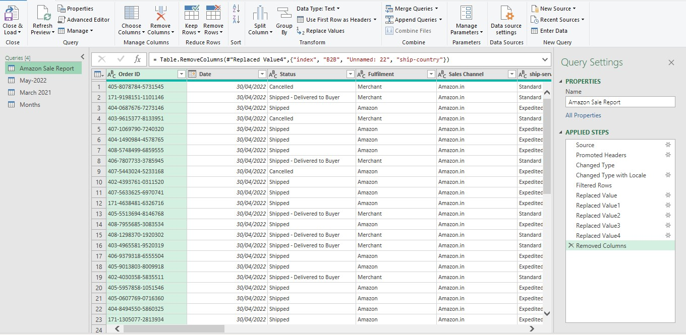

# Amazon Sales Analysis

An Excel sales-analysis project with Power Query preparation, a calendar-based data model and reporting assets.

[Download the Excel workbook](dashboard/repo%20Final.xlsx) · [Explore source files](data/)

## Problem Statement

Sales teams need to understand order activity by time, product and fulfillment status. This project organizes sales records into an Excel workflow for exploring those questions and reviewing the data preparation behind the analysis.

## Methodology

1. **Inspect source files:** review the sales, pricing and supporting CSV files under `data/` before combining them. Not every file has the same grain.
2. **Prepare with Power Query:** the existing screenshot documents header promotion, type conversion, locale-aware date conversion, filtering, value replacement and column removal.
3. **Model time:** the model screenshot shows a sales table linked to a Calendar table through a one-to-many date relationship.
4. **Explore the workbook:** inspect the Data Sales, Report and Visulization worksheets in Excel.
5. **Validate measures:** distinguish order counts, line quantities and monetary amounts, and document the treatment of cancelled orders.

## Workflow Screenshots

### Power Query preparation

### Calendar relationship

These are the repository's existing preparation and model screenshots, not a fabricated dashboard preview. A verified finished-dashboard screenshot is not available in the repository.

## Insights

- Order status and fulfillment method are separate fields, so shipment performance and sales activity should not be treated as the same metric.
- A dedicated Calendar table supports consistent month and year slicing.
- The supplied files cover different subjects, including product pricing. Adding every numeric column or appending every file would not produce a meaningful revenue total.

The previous README's dollar-denominated revenue claim is not repeated here: a verified currency definition and reproducible total are needed first.

## Business Recommendations

- Investigate cancellations by category and fulfillment method before proposing operational changes.
- Compare sales trends only across consistent date ranges and status definitions.
- Check product-level sales and stock context together before recommending replenishment.
- Confirm the currency and business meaning of Amount before publishing financial KPIs.

These are proposed analysis directions, not claims of measured business gains.

## How to Explore

1. Download `dashboard/repo Final.xlsx` and open it in desktop Excel with Power Query and Data Model support.
2. Review the workbook's existing sheets before refreshing.
3. Inspect query source paths and point them to the intended local CSV files where needed.
4. Refresh only after verifying the file mappings, data types and currency assumptions.

## Repository Guide

| Path | Contents |
| --- | --- |
| `dashboard/repo Final.xlsx` | Excel analysis workbook |
| `data/` | Sales, pricing and supporting CSV files |
| `src/Transform.jpg` | Power Query screenshot |
| `src/Data model.jpg` | Calendar relationship screenshot |
| `src/Data.jpg` | Existing sales-table screenshot |

## Limitations

This is a historical portfolio analysis, not a live connection to Amazon. Source-file mappings and refresh portability need review on a new machine. This documentation pass does not assert a new revenue total, a dashboard refresh or tested financial results.
